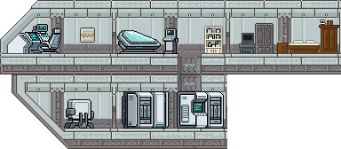

# 月上母舰舱室拼接

五张[手绘舱室 PNG](../ShipComponents)按原始像素比例拼成 **384 × 168** 的两层母舰。船底中心仍停在世界坐标 (260, −26400)。

| 甲板 | 船首 | 中部 | 船尾 | 整船局部地板 Y |
| --- | --- | --- | --- | --- |
| 顶层 | 驾驶舱 Cockpit | 医疗枢纽 MedsHub | 卧室 Bedroom | 60 |
| 下层 | 传送室 PortalRoom | 传送门控制室 PortalControlsHub | 船外留空 | 144 |

返航和救援落在顶层病床旁 (173, 51)。床右侧的井口直通下层控制室，井内净宽 25 像素（整船 x = 201–225）。控制屏交互点位于 (224, 143)，出发门位于左邻传送室的装置前 (91, 129)。卧室和其余舱室都沿用现有的藏身处访问权限。

## 替换美术

从 Resprite 按完整 **128 × 128** 画布导出透明 PNG，保留原文件名。[拼装脚本](assemble.py)统一截取原画布 y = 43–126，保留每格 128 × 84 的布局，包括斜船首左右两侧的透明留白。原图 y = 103 为地板，枢纽井口在 x = 73–97。可参考[空舱与枢纽的十字试拼](handbuilt_fit.png)。

在项目根目录用装有 Pillow 的 Python 运行 `python resources/Mothership/assemble.py`，会重建[船体美术](../../mods/noita_hideout/files/travel/cabin_background.png)和[材料碰撞图](../../mods/noita_hideout/files/travel/cabin_materials.png)。船壳和甲板使用原版无边纹圣山砖 `templebrick_noedge_static`（材料色 RGB 120, 108, 68）。家具和控制屏画在背景上，船体前景颜色也取自手绘图。脚本会检查五舱是否容得下 9 × 19 像素的站立轮廓，以及各互动位置的地板和净空。

每轮风暴进入核心阶段时登记一次修复。船体区块加载后重铺船壳、清空通道并补回缺失的控制台，地板与控制台就绪后记录修复完成。离开多个风暴周期后，返航时一次修至最新状态，已登记的航线和开启的传送门照常使用。

改变结构时同步调整[舱内坐标和范围](../../mods/noita_hideout/files/travel/cabin.lua)、[灯光](../../mods/noita_hideout/files/travel/console.xml)和场景版本。0.42.0 和 0.42.1 的船体各有一张卸除旧钢材用的静态遮罩，分别是 `prototype_clear.png` 和 `three_deck_clear.png`。
